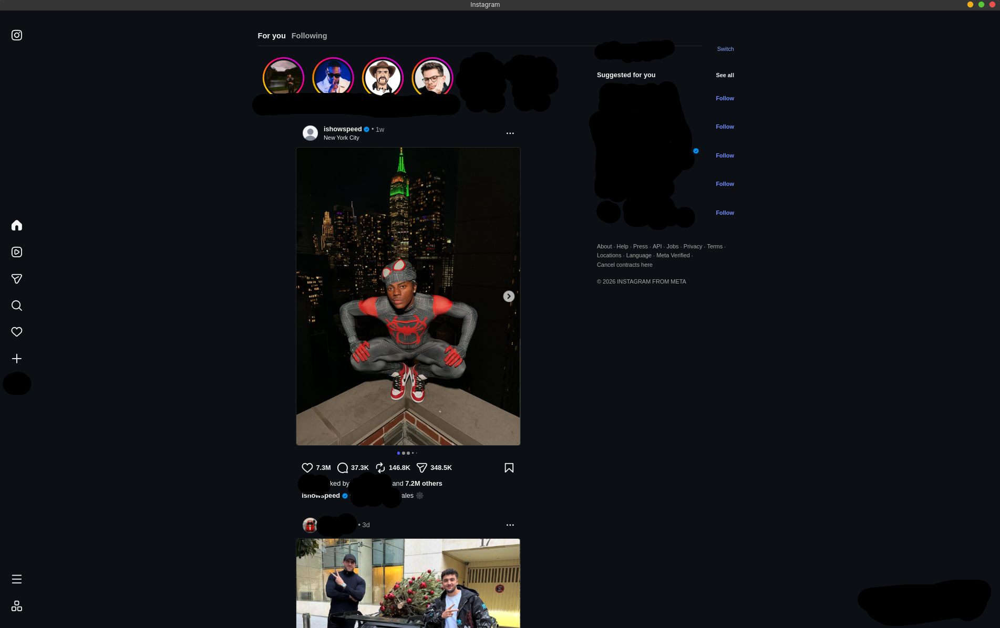
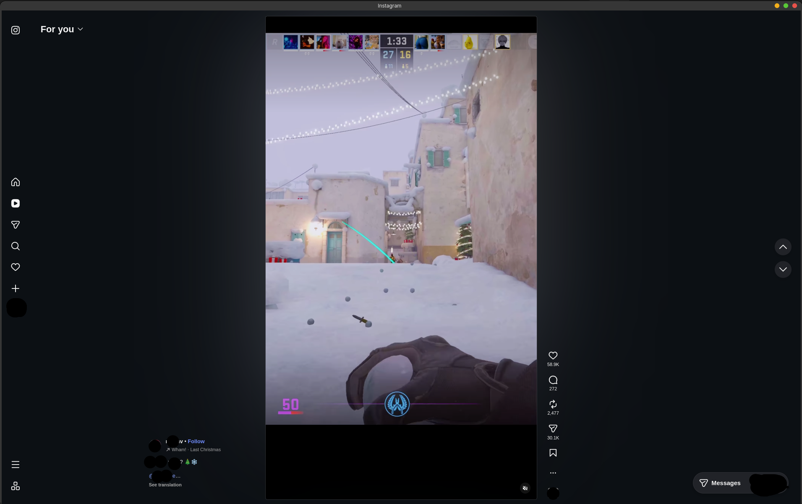

<div align="center">


# instaCache

**Instagram as a real Linux app.**<br>
Messages and calls ring, it starts with your session, and it weighs 2 MB.

[](https://github.com/LightZirconite/instaCache/releases)
[](LICENSE)


<br>

&nbsp;


</div>

## Install

```sh
curl -fsSL https://raw.githubusercontent.com/LightZirconite/instaCache/main/get.sh | sh
```

No root, nothing bundled. It installs into `~/.local`, adds itself to your
application menu and offers to install the Qt packages it needs. To remove it:
`~/.local/share/instacache/uninstall.sh`.

> **AUR:** an `instacache-bin` package is on its way but **not published
> yet**. Until it is, use the command above on Arch too.

## Why it is nice

- **A messenger, not a tab.** New messages make a sound and a real desktop
  notification, even with the window closed. Calls ring. Clicking a
  notification opens that conversation.
- **Always there, never in the way.** It starts with your session behind a
  tray icon. Closing the window keeps it running; `Ctrl+Q` quits.
- **Light when you are not looking.** In the background it does nothing until
  something arrives, freezes the page, and after 30 minutes gives its memory
  back.
- **Instant.** Your session and cache stay on disk, and the window comes back
  where, how big and on the page you left it.
- **2 MB, no Electron.** One Qt window over the Qt WebEngine your distribution
  already ships. Video is smooth: Reels play without the stutter of a
  WebKit-based client ([measured](bench/README.md)).
- **One app, not a browser.** Links and popups open over Instagram with a back
  button; anything that is not Meta's goes to your real browser.
- **Updates you can see.** New versions install by themselves; the next time
  you open the window it says so and restarts into it.
- **Several accounts, other sites.** `instacache --profile work` is a separate
  session and window. `instacache --add-site x https://x.com/` does the same
  for any site, with its own menu entry and icon.

## Shortcuts

| Keys | Action |
|---|---|
| `Ctrl+1` `Ctrl+2` `Ctrl+3` `Ctrl+4` | Feed · Explore · Reels · Direct |
| `Ctrl+R` · `Ctrl+Shift+R` | Reload · reload ignoring the cache |
| `Alt+←` · `Alt+→` | Back · forward, including out of a call |
| `Ctrl+=` `Ctrl+-` `Ctrl+0` | Zoom in · out · reset |
| `F11` | Fullscreen |
| `Ctrl+W` · `Ctrl+Q` | Close the page on top · quit for real |
| `F1` | Every shortcut and gesture, on a card |

The mouse's back and forward buttons work too.

On Instagram, the built-in mods add the phone's gestures:

| Gesture | Action |
|---|---|
| Double-click a picture or video | Like it, with a heart |
| Right-click a picture or video | Repost it |
| `Space` · `Space` `Space` | On Reels: the next reel · like this one and stay |
| `Enter` `Enter` | Like what is on screen |
| `L` `R` `S` `C` `M` | Like · repost · save · comments · sound |
| `O` | Turn the video sideways, full screen; again for the other way, a third time to put it back |
| `+` · `-` | Louder · quieter, remembered for every video after |
| Click a story · mouse wheel over it | Pause or play · next story or the one before |
| Mouse wheel over the stories row | Scroll the row |

The `?` in the bottom corner, `F1` and the tray menu all open the same card.

## Opening Instagram from your browser

instaCache answers to `instacache:` links: `instacache:https://www.instagram.com/reels/`
opens that page in the app. With [Violentmonkey](https://violentmonkey.github.io/)
or Tampermonkey, [`extras/open-in-instacache.user.js`](extras/open-in-instacache.user.js)
puts an *Open in instaCache* button on instagram.com, for the times you forgot
the app was there.

## Settings

The tray menu covers the everyday ones: start at login, notifications,
sounds, ringing, keep running when closed, and the mods: videos with sound,
Instagram's colours instead of black, colours that follow the post, animations,
shortcuts, and hiding "Also from Meta".

Everything else lives in `~/.config/instacache/config.json`, written with its
defaults on first run. A `user.css` or `user.js` beside it is applied to every
page.

<details>
<summary><b>Every setting</b></summary>

<br>

| Key | Default | What it does |
|---|---|---|
| `home_url` | `https://www.instagram.com/` | Page opened at startup and by `Ctrl+H`. |
| `user_agent` | `auto` | What Instagram is told. `auto` is Chrome on Linux at the engine's real version; empty keeps Qt WebEngine's own; anything else is sent as written. |
| `hardware_acceleration` | `always` | `never` turns GPU compositing off — only if the window renders wrong. |
| `video_decoding` | `gpu` | `gpu` (VA-API), `software` or `auto`. Change it only if playback misbehaves. |
| `allow_autoplay_with_sound` | `true` | Let videos start with sound. |
| `videos_with_sound` | `true`¹ | Unmute Instagram's videos as they start, instead of waiting for its speaker button. Muting one by hand stops it until the next load. |
| `video_volume` | `75` | The volume, from 0 to 100, that `videos_with_sound` starts a video at until you set one with `+` and `-`, which is remembered. |
| `instagram_colors` | `true`¹ | Tint Instagram's dark theme in its own colours instead of black, a little differently on each kind of page, with thin scroll bars. |
| `ambient_colors` | `true`¹ | With `instagram_colors`, the background takes on the colour of the picture or video in view, and drifts slowly while the page is at rest. |
| `shortcuts` | `true`¹ | Double-click a picture or video to like it, right-click to repost; on Reels Space twice likes the reel and stays on it, Enter twice likes; `L` like, `R` repost, `M` sound, `C` comments, `S` save or unsave, `O` turns a video sideways; a click pauses a story and the wheel moves between stories; the mouse wheel scrolls the stories row. |
| `hide_also_from_meta` | `true`¹ | Hide "Also from Meta" from Instagram's side bar. |
| `page_animations` | `true`¹ | Dialogs and pictures fade in. Off wherever the desktop asks for reduced motion. |
| `context_menu` | `false` | The engine's right-click menu, with "Save image as" and "Copy link address". With it on, a right-click no longer reposts. |
| `developer_tools` | `false` | The Web Inspector (`F12`). |
| `notifications` | `true` | Forward notifications to your desktop. |
| `push_notifications` | `true`¹ | Web Push, which is how messages arrive while the window is closed. Needs Qt 6.5. |
| `notification_sounds` | `true` | A short sound with each message. |
| `ring_for_calls` | `true`¹ | Ring for an incoming call until it is answered or dismissed. |
| `calls` | `true`¹ | Microphone and camera for calls in Direct. |
| `run_in_background` | `true`¹ | Closing the window hides it instead of quitting. |
| `freeze_in_background` | `true` | Freeze the page ten seconds after the window closes. Messages then arrive through Web Push and the unread badge waits. |
| `discard_in_background_after_minutes` | `30` | Free the page's memory after this long closed; it reloads when you open the window. `0` never does. |
| `http_cache_size_mb` | `1024` | Disk space for the resource cache, so Instagram's scripts survive an evening of video. `0` leaves it to Chromium, which chose about 300 MB. |
| `start_with_session` | `true`¹ | Start at login, in the background. Your desktop's startup settings win after the first run. |
| `unread_badge` | `true` | Unread count on the task bar icon. |
| `tray_icon` | `true`¹ | Tray icon. GNOME needs the AppIndicator extension. |
| `open_external_links_in_browser` | `true` | Send non-Meta links to your browser. |
| `internal_domains` | Instagram and Meta's login hosts | Hosts allowed inside the window. Add `threads.com` to keep Threads in. |
| `spell_checking_languages` | `[]` | e.g. `["en_US", "fr_FR"]`. |
| `default_zoom` | `1.0` | Zoom before any has been saved. |
| `remember_window_state` | `true` | Restore size, position and zoom. |
| `show_loading_indicator` | `true` | The thin bar at the top. |
| `start_maximized` | `false` | Always open maximized. |
| `auto_update` | `true` | Install new releases by itself. |
| `update_check_interval_hours` | `6` | Hours between checks. `0`: at launch only. |

¹ `false` for a site added with `--add-site`.

</details>

<details>
<summary><b>Command line</b></summary>

```
instacache [OPTIONS] [URL]

  <URL>                  Open this Instagram URL instead of your feed.
  -p, --profile <NAME>   Use a separate session, cache and window.
      --add-site <NAME> <URL>
                         Add a site to your application menu.
      --icon <PATH>      Use this image instead of the site's own logo.
      --remove-site <NAME>
                         Take it back out. Its data is kept.
      --list-sites       Show the sites you have added.
      --update           Check for a newer release and install it.
      --background       Start with the window hidden.
      --clear-cache      Delete cached resources, stay signed in.
      --clear-session    Delete cookies and site storage (signs you out).
  -h, --help             Full help.
  -V, --version          Version.
```

</details>

<details>
<summary><b>A call did not ring</b></summary>

<br>

Instagram does not mark a call, so instaCache recognises one from its words,
which differ by language. Show what actually arrived:

```sh
INSTACACHE_LOG_NOTIFICATIONS=1 instacache
journalctl --user -f | grep 'instacache: notification'
```

It is off by default and stays off: what a notification says is nobody's
business. Send the line for a call that did not ring and it is a quick fix.

</details>

<details>
<summary><b>Where your data lives</b></summary>

<br>

| Path | Contents | Safe to delete |
|---|---|---|
| `~/.config/instacache/` | settings, window geometry | yes, resets settings |
| `~/.local/share/instacache/` | cookies and site storage — your session | yes, signs you out |
| `~/.cache/instacache/` | the resource cache | yes, always |

Every path follows `XDG_*_HOME`, and nothing is written anywhere else.

</details>

## Requirements

Qt 6.4 or newer with `qt6-webengine`; `get.sh` installs it on Arch, Debian,
Ubuntu, Fedora, openSUSE and their derivatives. On Fedora, video also needs
`qt6-qtwebengine-freeworld`, which the installer adds.

## Build from source

```sh
git clone https://git.justw.tf/LightZirconite/instaCache
cd instaCache
cargo build --release
```

Needs Rust 1.82+ and the Qt 6 development packages (`qt6-base`,
`qt6-declarative`, `qt6-webengine`). Contributing? Start with
[`AGENTS.md`](AGENTS.md).

## Licence

[GNU AGPL-3.0-or-later](LICENSE) — use it, change it, share it; changes you
distribute or serve come back under the same licence. Copyright © 2026
LightZirconite; a commercial licence is possible on request.

<div align="center">
<br>
<sub>Not affiliated with, endorsed by, or connected to Instagram or Meta.</sub>
</div>
